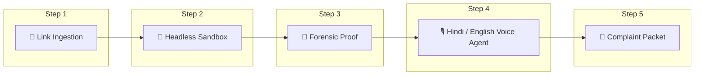

# ScamTrace 🛡️🔍

> **Rapid scam triage and forensic evidence capture in the critical first hour after fraud.**

---

## 🚨 The Problem: "The First Hour After a Scam"

When an individual falls prey to online financial fraud or cyber scams—be it a malicious APK link, an electric bill payment spoof, a fake job offer, or a fraudulent UPI refund request—**the first 60 minutes ("The Golden Hour") determine whether money and evidence can ever be recovered.**

Yet, this critical hour is almost always squandered due to three catastrophic bottlenecks:

1. **The Panic & Confusion Paralysis**: Victims experience severe distress and disorientation. Instead of taking rapid remedial actions (e.g., locking cards, freezing net banking, flagging UTR numbers with their bank), victims panic, search randomly on search engines, or fall into secondary scams.
2. **Volatile Evidence Disappearance**: Phishing infrastructure is ephemeral. Malicious short links expire, scam websites self-destruct or block IP addresses, Telegram channels are scrubbed, and scammers delete chat histories for both parties within minutes. By the time an investigator looks at the case, the link leads to a 404.
3. **The Language & Technical Barrier**: Most victims—particularly seniors and non-English vernacular speakers—cannot navigate technical jargon or complex cybercrime portals. Explaining what a "domain header", "UTR number", or "APK SHA-256 fingerprint" is during an emergency is impossible.

ScamTrace exists to turn that frantic first hour into an automated, calm, and forensically sound response.

---

## 🔄 The Flow

ScamTrace automates the end-to-end incident response lifecycle in 5 integrated steps:

```
[ Link ] ──▶ [ Sandbox ] ──▶ [ Proof ] ──▶ [ Hindi/English Voice ] ──▶ [ Complaint Packet ]
```



### 1. 🔗 Link (Safe Ingestion)
The victim or first responder pastes the suspicious URL, SMS link, QR destination, or fraudulent payment gateway link into ScamTrace via web or mobile interface.

### 2. 🧪 Sandbox (Isolated Execution)
The link is immediately detonated inside an isolated headless browsing environment (Chromium sandbox):
- Emulates authentic mobile and desktop browser user-agents.
- Safely follows and records HTTP redirect chains and cloaked endpoints.
- Intercepts outbound network calls, DNS queries, and destination IP lookups without exposing the victim's device or network.

### 3. 📸 Proof (Automated Forensic Capture)
Before the scammer can pull down the domain, ScamTrace creates an immutable, timestamped digital evidence vault:
- **Full-page visual screenshot** of the landing page, forms, and spoofed UI.
- **Raw DOM snapshot** capturing malicious scripts and hidden form fields.
- **HAR (HTTP Archive) trace** documenting server IPs, SSL certificates, response headers, and tracking IDs.
- **Cryptographic hashing (SHA-256)** across all artifacts to establish non-tampering and support preserving electronic evidence for a legal certificate under Section 63 of the Bharatiya Sakshya Adhiniyam (BSA, 2023).

### 4. 🎙️ Hindi / English Voice (Empathetic Triage & De-escalation)
A conversational bilingual voice assistant speaks to the user in **Hindi** (हिंदी) and **English**:
- **De-escalation & Triage**: Calms the victim down and instructs them on immediate emergency measures (*"कृपया घबराएं नहीं। आगे कोई पैसे न भेजें। अपना बैंक कार्ड और UPI तुरंत ब्लॉक करें..."* / *"Please do not panic. Do not transfer any more funds. Block your bank card and UPI immediately..."*).
- **Interactive Fact-Finding**: Converses naturally in Hindi/Hinglish/English to collect crucial, non-technical details:
  - Bank name and transaction method (UPI / IMPS / Net Banking).
  - Transaction reference / UTR number from the SMS.
  - Approximate timestamp and amount lost.
  - Scammer's mobile number, UPI ID, or WhatsApp handle.
- Converts spoken statements into structured digital claims via Speech-to-Text (STT) and structured entity extraction.

### 5. 📄 Complaint Packet (One-Click Legal & Banking Dossier)
Generates an all-in-one, standardized Cybercrime & Bank Dispute Dossier ready for immediate submission:
- **National Cybercrime Reporting Portal (1930 / cybercrime.gov.in) Form**: Pre-formatted data fields ready for quick copy-paste or autofill.
- **Bank Nodal Grievance Letter**: Formal urgent dispute request to investigate, place an immediate lien/hold on beneficiary funds across the recipient bank, and initiate interbank fraud recall protocols (addressing Authorized Push Payment fraud with no guarantee of liability).
- **Police Cyber Cell Report**: Formal complaint draft with complete chronological incident narrative and scammer identification markers.
- **Forensic Annexure**: Attached screenshots, DNS/IP proof, redirect chain analysis, and SHA-256 checksums.

---

## 📊 Status

| Component | Status | Details |
|---|---|---|
| **Forensic URL Sandbox** | 🟡 Alpha Prototype | Headless Chromium engine configured for redirect extraction and HAR capture |
| **Evidence Locker & Hasher** | 🟡 Prototype | Automated screenshot & SHA-256 checksum generation pipeline |
| **Hindi / English Voice Interface** | 🟡 In Development | Bilingual STT/TTS prompt workflow tuned for panic de-escalation in Hindi & English |
| **Complaint Packet Generator** | 🟢 Designed | Markdown & PDF dossier generator for 1930, Bank Grievance, and Police complaint |
| **End-to-End Orchestrator** | 🟡 Work in Progress | Unifying the link intake, sandbox capture, voice triage, and packet export |

---

## 🚀 Getting Started

### Prerequisites
- Node.js (v18+) or Python (3.10+)
- Chromium / Playwright for sandbox browser automation
- Git

### Installation & Setup

1. **Clone the repository:**
   ```bash
   git clone https://github.com/comosag56/scamtrace.git
   cd scamtrace
   ```

2. **Install dependencies:**
   ```bash
   npm install
   ```

3. **Install Playwright Chromium browser:**
   ```bash
   npx playwright install chromium
   ```

4. **Configure environment variables:**
   ```bash
   cp .env.example .env
   ```
   Add your Groq API key(s) in `.env` (supports up to 3 keys for automatic rate-limit failover).

5. **Run test verification suite:**
   ```bash
   npm test
   ```

6. **Start the ScamTrace server:**
   ```bash
   npm start
   ```
   The server will start listening at `http://localhost:3000`.

---

## ⚖️ License & Mission
ScamTrace is designed to democratize cyber safety and empower vulnerable citizens during their most vulnerable hour. Distributed under the MIT License.
